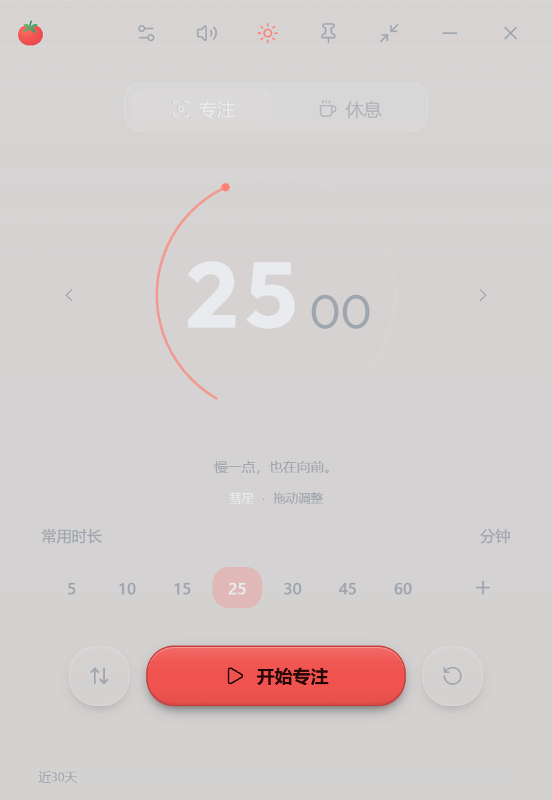

# Pomodoro Timer · 番茄时钟

[简体中文](README.md) · **English**

Start a focus session and take a break when time is up. Switch to the floating mini window to keep the remaining time in view while you work.

Pomodoro Timer is a Windows desktop app. Focus and break sessions keep their own progress, so you can switch between them and pick up where you left off. Your settings, imported sounds, and focus history stay on your device.

[Download the Windows installer](https://github.com/aioo-code/pomodoro-tauri/releases/latest) · [Install and get started](#install-and-get-started) · [Run from source](#run-from-source) · [Contribute](CONTRIBUTING.md)



## Install and get started

[Download the 0.6.0 Windows x64 installer](https://github.com/aioo-code/pomodoro-tauri/releases/download/v0.6.0/pomodoro-tauri-0.6.0-windows-x64-setup.exe) from GitHub Releases. The installer is unsigned. Verify your download against [SHA256SUMS.txt](https://github.com/aioo-code/pomodoro-tauri/releases/download/v0.6.0/SHA256SUMS.txt).

The app has been tested on **Windows 11 x64** and requires the Microsoft Edge WebView2 Runtime. The installer downloads the runtime if it is missing.

1. Choose **Focus** or **Break** in the main window. The defaults are 25 and 5 minutes, respectively.
2. Choose a preset under **Durations** or drag the dial to adjust the remaining time. Select **Start focus** or **Start break** to begin.
3. A reminder appears when the session ends. To keep the timer in a corner of your screen, switch to the mini window from the title bar and pin it on top if desired.

## Features

- **Timer** shows remaining or elapsed time. Pause, resume, or reset the current session, and edit your duration presets in Settings.
- **Display** offers five styles called Comet, Halo, Droplet, Ticks, and Digits. The mini window can show digits or a progress bar, snap to screen edges, and stay on top.
- **Sound** lets you adjust interaction and reminder volumes separately, mute the app, and import local audio.
- **Focus history** counts completed focus sessions by day and shows the last 30 days as a heatmap in the main window.

## Run from source

On Windows, install Node.js 24 LTS, stable Rust 1.90 or later with the MSVC toolchain, Visual Studio Build Tools with the Desktop development with C++ workload, and the WebView2 Runtime. Open PowerShell in the project root.

```powershell
npm.cmd ci
npm.cmd run dev
```

Build and launch the standalone Windows executable.

```powershell
npm.cmd run build
& './src-tauri/target/release/pomodoro-connected.exe'
```

## Test

After installing the dependencies, run the type and formatting checks and the Rust unit tests from the project root.

```powershell
npm.cmd run check
npm.cmd test
```

Build the app before running the local desktop tests. If that build is already running, exit it from the system tray first. The script uses separate test settings to verify focus and break timing, mini-window switching, and end-of-session reminders. It writes the results to `artifacts/desktop-acceptance/`.

```powershell
npm.cmd run test:desktop
```

## More resources

- [Contributing guide](CONTRIBUTING.md)
- [Local timer commands](scripts/tool-call.ps1)
- [Report a security issue](SECURITY.md)

## License

The project's original code and documentation are licensed under [MIT](LICENSE).

React Bits, the Outfit font, and other third-party materials retain their respective licenses. See the [third-party notices](THIRD_PARTY_NOTICES.md) for sources and distribution terms.
