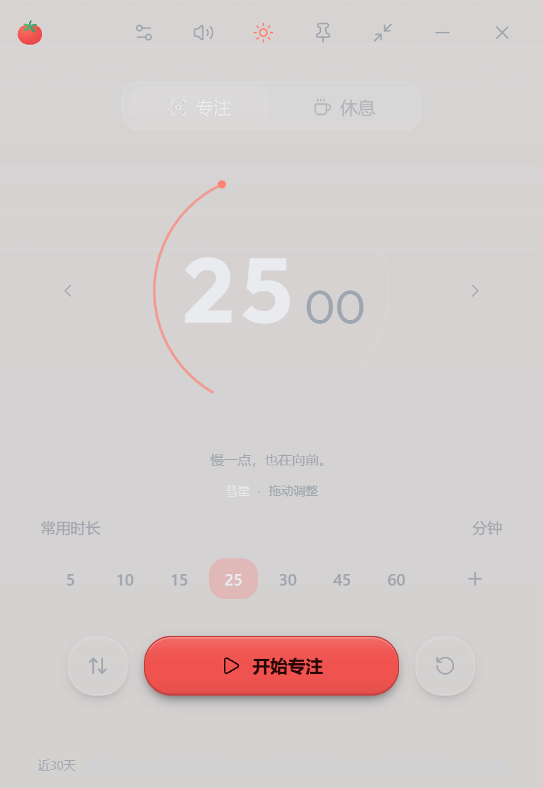

# 番茄时钟 · Pomodoro Timer

**简体中文** · [English](README.en.md)

开始一段专注，到点休息。把时钟缩成一个置顶小窗，就能边工作边看剩余时间。

番茄时钟是 Windows 桌面应用。专注和休息各有独立的进度，切换时段后可以回到原处继续。设置、导入的声音和近 30 天的专注记录都保存在本机。

[下载 Windows 安装包](https://github.com/aioo-code/pomodoro-tauri/releases/latest) · [安装与上手](#安装与上手) · [从源码运行](#从源码运行) · [参与贡献](CONTRIBUTING.md)



## 安装与上手

从 GitHub Releases [下载 0.6.0 Windows x64 安装包](https://github.com/aioo-code/pomodoro-tauri/releases/download/v0.6.0/pomodoro-tauri-0.6.0-windows-x64-setup.exe)。安装包未签名，可用发行页的 [SHA256SUMS.txt](https://github.com/aioo-code/pomodoro-tauri/releases/download/v0.6.0/SHA256SUMS.txt) 核对下载文件。

已在 **Windows 11 x64** 上验收。应用需要 Microsoft Edge WebView2 Runtime，安装器会在缺少运行时时联网安装。

1. 在主窗选择「专注」或「休息」。默认分别为 25 分钟和 5 分钟。
2. 从「常用时长」选一个预设，或拖动计时盘调整剩余时间。点「开始专注」或「开始休息」启动计时。
3. 到时会弹出提醒。想把时钟留在屏幕一角，可以从标题栏切换到小窗，并按需置顶。

## 功能

- **计时**支持倒计时和已用时间显示，可以暂停、继续和重置当前时段。常用时长可在设置里编辑。
- **显示**提供彗星、光环、水滴、刻度和字面五种样式。小窗可在数字和进度条之间切换，支持贴边和置顶。
- **声音**可分别调节交互音效和到时提醒的音量，支持快速静音及导入本地音频。
- **专注记录**按天统计完成的专注次数，在主窗查看近 30 天的热力图。

## 从源码运行

在 Windows 上准备 Node.js 24 LTS、Rust stable（MSVC 工具链，至少 1.90）、Visual Studio Build Tools 的 C++ 桌面开发工作负载和 WebView2 Runtime。在项目根目录打开 PowerShell。

```powershell
npm.cmd ci
npm.cmd run dev
```

构建可独立运行的 Windows 程序并打开它。

```powershell
npm.cmd run build
& './src-tauri/target/release/pomodoro-connected.exe'
```

## 验收

在装好依赖的项目根目录检查类型和格式，运行 Rust 单元测试。

```powershell
npm.cmd run check
npm.cmd test
```

构建程序后可运行本机桌面验收。如果正在运行同一份程序，请先从托盘退出。脚本使用独立的测试设置，检查专注和休息计时、小窗切换及到时提醒。验收记录写入 `artifacts/desktop-acceptance/`。

```powershell
npm.cmd run test:desktop
```

## 更多资料

- [贡献指南](CONTRIBUTING.md)
- [本机计时命令](scripts/tool-call.ps1)
- [安全问题报告](SECURITY.md)

## 许可证

项目自有代码和文档采用 **MIT**，详见[许可证全文](LICENSE)。

React Bits、Outfit 字体及其他第三方材料适用各自的许可条款。来源和分发条件见[第三方许可说明](THIRD_PARTY_NOTICES.md)。
